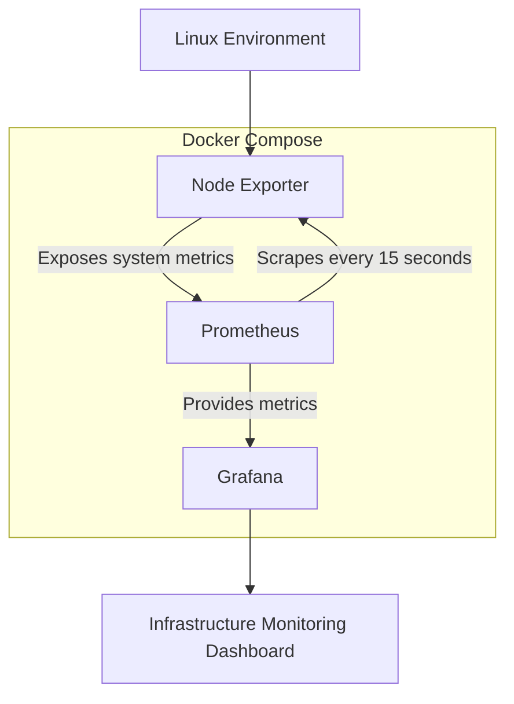

# InfraPulse — Linux Infrastructure Monitoring

InfraPulse is a containerized infrastructure monitoring project that collects and visualizes Linux system performance metrics using Prometheus, Grafana, and Node Exporter.

The project provides a centralized dashboard for observing CPU usage, memory consumption, disk utilization, network traffic, and system uptime.

## Architecture



## Technology Stack

| Technology | Purpose |
|---|---|
| Ubuntu Linux (WSL 2) | Monitoring environment |
| Docker | Container runtime |
| Docker Compose | Service orchestration |
| Node Exporter | Linux system metrics collection |
| Prometheus | Metrics collection and storage |
| Grafana | Monitoring dashboards |

## Monitored Metrics

The Grafana dashboard contains five panels:

1. **CPU Usage** — Displays CPU utilization as a percentage.
2. **Memory Usage** — Displays memory utilization as a percentage.
3. **Disk Usage** — Displays root filesystem utilization as a percentage.
4. **Network Traffic** — Displays incoming and outgoing network traffic in bytes per second.
5. **Server Uptime** — Displays system uptime in seconds.

Dashboard refresh interval: 10 seconds.

Prometheus scrape interval: 15 seconds.

Prometheus data retention: 7 days.

## Project Structure

```text
InfraPulse/
├── docker-compose.yml
├── .env.example
├── .gitignore
├── README.md
│
├── prometheus/
│   └── prometheus.yml
│
└── grafana/
    ├── dashboards/
    │   └── infrapulse-dashboard.json
    │
    └── provisioning/
        ├── dashboards/
        │   └── dashboard.yml
        │
        └── datasources/
            └── prometheus.yml
```

## Getting Started

### Prerequisites

- Ubuntu Linux or another supported Linux environment
- Docker Engine
- Docker Compose plugin
- Git

### 1. Clone the repository

```bash
git clone https://github.com/DeborahNdubuisi/InfraPulse.git
cd InfraPulse
```

### 2. Configure environment variables

Create your local environment file:

```bash
cp .env.example .env
```

Edit the file:

```bash
nano .env
```

Set a secure Grafana administrator password:

```env
GRAFANA_ADMIN_PASSWORD=your_secure_password
```

Save the file.

**Security:** Never commit your `.env` file or publish your actual credentials.

### 3. Start the monitoring stack

```bash
sudo docker compose up -d
```

### 4. Verify running containers

```bash
sudo docker compose ps
```

The following services should be running:

- infrapulse-node-exporter
- infrapulse-prometheus
- infrapulse-grafana

### 5. Access the services

| Service | Local URL |
|---|---|
| Grafana | http://localhost:3000 |
| Prometheus | http://localhost:9090 |
| Node Exporter metrics | http://localhost:9100/metrics |

Grafana login:

- Username: `admin`
- Password: The value configured in your `.env` file.

The InfraPulse dashboard is automatically provisioned through Grafana's provisioning configuration.

### 6. Stop the monitoring stack

```bash
sudo docker compose down
```

To stop the containers without removing persistent data, use the command above.

## Prometheus Configuration

Prometheus is configured to:

- Scrape metrics every 15 seconds.
- Collect metrics from Node Exporter.
- Monitor its own service.
- Retain metrics for 7 days.

## Security Considerations

- Service ports are bound to `127.0.0.1` for local access.
- Grafana credentials are supplied through environment variables.
- `.env` is excluded from Git using `.gitignore`.
- Grafana dashboards and data are stored using Docker volumes.

## Testing and Validation

The following checks have been performed:

- Docker Engine installation and verification.
- Docker Compose configuration validation.
- Successful startup of all three monitoring containers.
- Node Exporter metrics endpoint verification.
- Prometheus scrape target verification.
- Grafana dashboard provisioning.
- Verification of all five dashboard panels with live metrics.
- Verification of credential protection and Git exclusions.

## Current Monitoring Scope

InfraPulse currently monitors the Ubuntu environment running inside WSL 2 on a Windows machine.

It does not currently monitor the entire Windows host or an external production server.

The project is designed as a local infrastructure monitoring implementation and can be extended to monitor additional Linux hosts.

## Future Improvements

- Monitor additional Linux servers.
- Add infrastructure alerting with Alertmanager.
- Configure CPU, memory, and disk usage alerts.
- Extend monitoring to remote environments.
- Improve dashboard observability.

## Author

**Deborah Ndubuisi**

GitHub: [DeborahNdubuisi](https://github.com/DeborahNdubuisi)
